<div align="center">


<a href="https://github.com/GregoryKz">
  
</a>

<br/>

<a href="https://www.linkedin.com/in/gregory-klaus-silva-pereira-4a0841228/"></a>
<a href="https://gregorykz.github.io/portfolio-website/"></a>


</div>

---

## `> whoami`

```js
const klaus = {
  cargo:  "Desenvolvedor Trainee",
  stack:  ["PHP", "Python", "JavaScript", "SQL"],
  extra:  ["Node.js", "React", "Java", "C#"],
  foco:   ["Web", "APIs", "Automação", "IA"],
  ensino: ["Senac", "Proa"],
  lema:   "Tecnologia que transforma pessoas",
};
```

Desenvolvo aplicações e sistemas web da modelagem ao deploy e uso **Inteligência Artificial** como parte ativa do meu fluxo de trabalho, para entregar mais rápido, resolver problemas e aprender sem parar.

Em sala de aula, ajudo alunos a construir lógica de programação, fundamentos de desenvolvimento web e pensamento computacional. Explicar ideias complexas de forma simples é tão importante para mim quanto escrever código.

> *"De onde vim, aonde cheguei, e o que posso construir daqui pra frente."*

---

## `> stack --list`

<div align="center">

**Linguagens e back-end**


**Front-end**


**Dados e ferramentas**


</div>

---

## `> ls ./projetos --destaque`

| Projeto | O que é | Stack |
|---|---|---|
| 🔗 [**integracao-omie**](https://github.com/GregoryKz/integracao-omie) | Integração financeira com o ERP Omie: contas a pagar multi-CNPJ e rateio por centro de custo | PHP · API REST |
| 🤟 [**reconhecimento-libras**](https://github.com/GregoryKz/reconhecimento-libras) | Reconhecimento de Libras (Língua Brasileira de Sinais) para aplicações acessíveis | Python |
| 💰 [**cash-flow-api**](https://github.com/GregoryKz/cash-flow-api) | API de fluxo de caixa | Node.js · Express · MySQL |
| 🎬 [**senac-web2-cine-ghibli**](https://github.com/GregoryKz/senac-web2-cine-ghibli) | Catálogo de filmes do Studio Ghibli consumindo API | HTML · CSS · JavaScript |
| 🛍️ [**react-vitrine-digital**](https://github.com/GregoryKz/react-vitrine-digital) | Vitrine digital KsTech, projeto final de React | React · Vite |
| 🎓 [**devance**](https://gregorykz.github.io/devance/) | Plataforma de aprendizado, projeto do Demoday | HTML · CSS · JavaScript |
| 🔎 [**buscador-perfil-github**](https://gregorykz.github.io/buscador-perfil-github/) | Busca perfis do GitHub via API: avatar, bio, repositórios e seguidores | JavaScript · API |
| 🃏 [**super-trunfo**](https://gregorykz.github.io/super-trunfo/) | Jogo Super Trunfo de carros antigos contra a máquina | JavaScript |

---

## `> git log --stats`

<div align="center">


</div>

---

## `> ./drift --burnout contributions`

<div align="center">

<picture>
  <source media="(prefers-color-scheme: dark)" srcset="https://raw.githubusercontent.com/GregoryKz/GregoryKz/output/drift-dark.svg">
  <source media="(prefers-color-scheme: light)" srcset="https://raw.githubusercontent.com/GregoryKz/GregoryKz/output/drift.svg">
  
</picture>

<sub>🏎️💨 Atualizado todo dia: um carro fazendo drift em cima das minhas contribuições do último ano.</sub>

</div>


